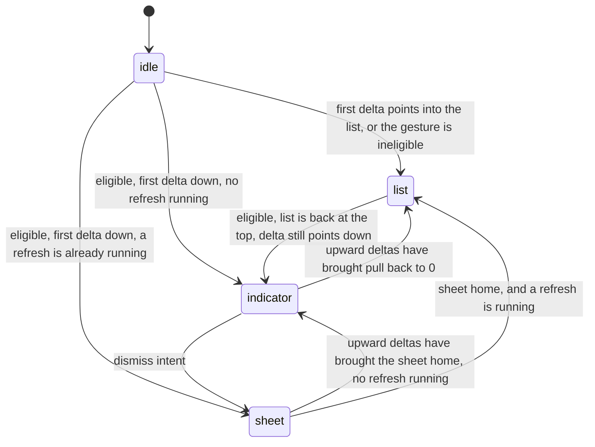

# How a pull becomes a scroll, a refresh, or a dismiss

This describes the model in the code, and how the `[RSheet]` logs are meant to be used to tune it. The design history, the rejected alternatives, and the experiment plan are in [refresh-vs-dismiss-arbitration.md](analysis/refresh-vs-dismiss-arbitration.md). Where that plan and the code disagree, the code wins; the differences are listed in section 9 of the plan. The experiments in section 7 of the plan have not been run. The thresholds below are the starting values in `RefreshSheetArbitrationConfig`.

The scrollable keeps the pointer. The package never asks the gesture arena to choose. On every move it takes the drag delta the list was about to apply and gives that delta to exactly one of three owners: the list, the refresh indicator, or the sheet.

## The seam

```
Listener                         samples the pointer; does not enter the arena
PointerHistory                   velocity, run, straightness, jitter; no decisions
_SheetScrollPosition.applyUserOffset
                                 calls RefreshSheetArbitrator.route
_SheetScrollPosition.goBallistic
                                 calls RefreshSheetArbitrator.release
```

`applyUserOffset` and `goBallistic` are the same two methods the framework's Cupertino sheet overrides. The list's own recognizer still owns slop, multi-touch, and drag start. The arbitrator only sees a delta after that recognizer has accepted the gesture.

A positive delta is the finger moving down. `goBallistic` receives the negation of that finger velocity, and the scroll position flips it back before `release`.

One delta can change owner in the middle. The arbitrator walks the leftover, at most eight steps, and returns only the part the list must apply. The rest is added to `pull` (indicator) or `sheetOffset` (sheet). Both are sums of deltas that owner already took, so a takeover does not jump.

## Who may leave the list

Eligibility is fixed when the scroll drag starts, in `_SheetScrollPosition.drag`. A gesture is eligible only when all of these hold:

- the route is current
- the list was at rest when the finger landed (`hold` records this; a finger that stops a fling or a bounce is ineligible)
- the pointer is touch, stylus, or inverted stylus
- the scroll axis points down (a reversed list is ineligible)
- the scroll offset is within `edgeSlop` (1 px) of the leading edge

An ineligible gesture stays in `list` until the finger lifts. That covers a drag that starts mid-list, a finger that catches a moving list, a mouse drag, and a drag during the route's entry animation. A drag that catches a sheet already springing back stays on the sheet. Mouse wheel and trackpad never become a drag of this kind, so they only scroll the list.

A second finger does not change the current owner. It freezes takeovers until every finger has lifted.

## States

| State | What tracks the finger | List | Indicator | Sheet |
|---|---|---|---|---|
| `idle` | nothing yet | at rest, or ballistic | hidden, or a refresh already running | open, or springing back |
| `list` | list content | stock physics, including platform overscroll | unchanged | open |
| `indicator` | the indicator | pinned at the top | `pull` grows with the finger; armed once `pull` reaches the arm distance | open |
| `sheet` | the sheet | pinned at the top | retracts | translated by `sheetOffset` |

After the finger lifts, the indicator and the sheet may still animate. Those animations do not follow the finger. The indicator's phases are retract, snap-and-refresh, and done. The sheet either springs back to fully open or the route pops.



Upward movement unwinds the current owner first, then the leftover is given to the previous one, inside the same gesture. A reversal does not need a new pointer-down.

## The first delta

From `idle`, the first delta chooses:

- downward, and the list is at the top: the indicator, or the sheet when a refresh is already running and the sheet may be dragged
- anything else: the list

While a refresh is running, a second indicator pull has no meaning, so an eligible downward pull goes straight to the sheet. The spinner stays visible and travels with the sheet. If the sheet closes, the `onRefresh` future is left to finish and its result is dropped.

While the gesture is in `list`, downward movement is given to the list until the list is at its top. Leftover downward movement then enters the indicator, but only for an eligible gesture. An ineligible gesture that arrives at the top keeps the platform's own overscroll. A drag that started mid-list and reaches the top with the finger still down stays a list scroll.

## What separates a refresh from a dismiss

There is no distance gate. A slow pull never moves the sheet, however far it travels. The sheet takes over from the indicator only when the current run is a dismiss.

A run is the movement since the last reversal. A reversal is an opposite move larger than `reversalHysteresis` (8 px). Smaller sign changes are jitter, not a new run.

Dismiss intent, evaluated on every downward delta while the state is `indicator`:

```
vertical   = over the current run, |dy| >= 2 * |dx|
             and straightness >= 0.85
             (straightness = net displacement / path length)

fast       = at least 40 ms since pointer down
             and the run is at least 32 px
             and fewer than 2 direction flips in the last 100 ms
             and smoothed velocity >= the band's gate
             and instantaneous velocity >= half that gate

committed  = the indicator is armed
             or more than 200 ms have passed since pointer down

dismiss    = vertical and fast
             and the sheet can be dragged
             and one finger
             and the run points down
             and (not committed, or refreshCanBecomeDismiss)
```

The band is chosen from where the finger landed. The top band is the top 33% of the list viewport and uses 1100 px/s. Below that, the body uses 800 px/s. Smoothed velocity comes from Flutter's `VelocityTracker` (100 ms horizon). Instantaneous velocity is the last sample's `dy / dt`, so a finger that has already slowed down does not ride a stale smoothed estimate.

The arm distance is 25% of the viewport, the same fraction the stock indicator uses. Arming has 12 px of hysteresis on the way back down. With `refreshCanBecomeDismiss` left at its default, `true`, arming and the 200 ms deadline do not block a later fast run. Set it to `false` and a pull that has armed, or that has been tracked past the deadline, stays a pull.

`sheetOffset` is applied to the route's animation controller with the stock formula, `value = 1 - sheetOffset / sheetHeight`. While the route is popping, the controller is left alone.

## What a release commits to

| State when the finger lifts | Commit |
|---|---|
| `idle` or `list` | the list flings with its own physics |
| `indicator`, not armed, or the pointer was cancelled | the indicator retracts; `onRefresh` is not called; the list gets no fling |
| `indicator`, armed | the indicator snaps to its resting displacement and `onRefresh` runs |
| `sheet`, and the downward release speed is at least 700 px/s, or `sheetOffset` is at least half the sheet height | the route pops |
| `sheet`, otherwise | the sheet springs back to fully open |
| pointer cancel | retract or spring back; never refresh, never close |

The 700 px/s and the half-height threshold are the stock sheet's release rules, applied to a sheet that has already been following the finger.

In `indicator` and `sheet`, edge deltas are not passed to the list, so iOS does not bounce and Android does not glow. In `list`, each platform keeps its own physics. Nothing forces `ClampingScrollPhysics`.

## The log

`debugRefreshSheetLogs` defaults to false. While it is true, every decision is printed with the prefix `[RSheet]`. The example turns it on and copies `debugPrint` into `GestureLog`, which the tuning overlay reads.

The overlay shows three lines while you drag: the live `describe()` snapshot, the last transition, and the last release. Under them are three labels, `refresh`, `dismiss`, and `scroll`, and a button that copies the session. Each label is attached to the gesture that contains the latest `begin:` line. The copy format is:

```
## gesture 1 wanted=refresh
begin: ...
delta ...
release: ...

## gesture 2 wanted=?
...
```

`wanted=?` means the tester has not labelled that gesture. Unlabelled gestures cannot be scored.

### Lines that belong to one gesture

A gesture record starts at `begin:`. Lines printed earlier in the same touch (`pointer down`, `hold`, `drag start`) are attached to the previous gesture, or dropped when the log is empty. `build:` lines are rebuild noise and land on whichever gesture is open. When you score a session, read `begin:`, the `->` transitions, `armed` / `disarmed`, the `delta` lines, and `release:`.

| Line | When it is printed | What to read off it |
|---|---|---|
| `begin:` | drag start | `eligible`, `band` (`top` or `body`), `refreshing`, `sheetEnabled`, viewport `V`, sheet height `H`, arm distance |
| `A -> B (reason) \| …` | the owner changes | the reason: `first delta`, `list reached its top`, `dismiss intent`, `indicator unwound`, `sheet home` |
| `armed at pull` / `disarmed at pull` | pull crosses the arm distance, with hysteresis on the way down | the pull, in px, at the crossing |
| `delta D -> list L \| …` | every accepted move | how the delta was split, plus the full decision snapshot |
| `release:` | finger up | the state, the commit (`list`, `retract`, `refresh`, `close`, `springBack`), release speed, `pull`, `sheet`, `cancelled` |
| `onRefresh started` / `onRefresh finished` | the refresh future | whether a refresh commit actually ran, and whether the widget was still mounted |
| `pointer cancel` | the listener saw a cancel | the following release must not refresh or close; the scroll recognizer reports an accepted drag's cancel as a normal end, so this line is the real signal |
| `route push animation` / `route pop animation` | entry or exit simulation | the controller value the animation started from |

`drag start` is the eligibility evidence: `isCurrent`, `restAtDown`, pointer `kind`, `pixels` against `min`, `enableDrag`, and the route controller value. Use it when a gesture you expected to arbitrate went entirely to the list.

### The snapshot on every transition and every delta

```
t=86ms state=indicator pull=48.0 sheet=0.0 vSmooth=920 vInst=880 run=46.0/2.0 straight=0.99 flips=0 multi=false
```

| Field | Meaning | Compared with |
|---|---|---|
| `t` | time since pointer down | 40 ms hold-off, 200 ms deadline |
| `state` | current owner; `(armed)` when the indicator is armed | the commit table |
| `pull`, `sheet` | pixels that owner has accumulated | arm distance from `begin:`; `0.5 * H` at release |
| `vSmooth` | smoothed downward px/s | 1100 in the top band, 800 in the body |
| `vInst` | last sample, px/s | half of that gate |
| `run` | `dy/dx` of the current run, px | `\|dy\| >= 2 \|dx\|`, and `dy >= 32` before velocity counts |
| `straight` | net displacement / path length of the run | 0.85 |
| `flips` | direction changes inside the last 100 ms | 2 or more blocks the velocity gate |
| `multi` | a second finger has landed | takeover stays frozen |

A missing `indicator -> sheet (dismiss intent)` line means every one of those checks failed on every sample. The last `delta` line before release is the one to read: it is the closest the gesture came.

## Using a session to change the model

The loop the example is built for:

1. Run the example on a device (`cd example && fvm flutter run`). Pick one sheet variant and one physics override and leave them there for the whole session.
2. Perform the gesture you care about, then tap the label for what you wanted: `refresh`, `dismiss`, or `scroll`.
3. Copy the session. Score each gesture by comparing `wanted` with the `release:` commit and with whether a `dismiss intent` transition exists.
4. For every miss, name the single check that failed, from the table above. Change that one field on the tuning sliders, or in `RefreshSheetArbitrationConfig`, and repeat the same set.
5. When a device trace shows a rule the current checks cannot express, add a replay in `test/arbitrator_test.dart`. The existing "slow pull that turns fast" test is one of those traces: a short slow move, a pause past the deadline, then a flick, which must stay on the indicator when `refreshCanBecomeDismiss` is false.

Score a gesture as a hit when:

| Label | Hit |
|---|---|
| `refresh` | release commit is `refresh` or `retract`, and there is no `dismiss intent` transition |
| `dismiss` | there is a `dismiss intent` transition, and the release commit is `close` or `springBack` |
| `scroll` | release commit is `list`, `pull` stays 0, and `sheet` stays 0 |

`retract` against `wanted=refresh` is a short pull, not a misclassification, as long as the sheet never took over. `springBack` against `wanted=dismiss` means the handoff was right and the release was short of 700 px/s and of half the sheet. Count that separately from a pull that never left the indicator.

### Which misses move which number

These are the section 7 questions, read off the export.

**Velocity gate (E1, E2).** From `wanted=refresh` and `wanted=dismiss` gestures that start at `band=top`, take the largest `vSmooth` on a `delta` line while `state=indicator` and the snapshot is not `(armed)`. If those two sets overlap so much that no threshold keeps both error rates under 10%, velocity alone does not separate them. Otherwise set `dismissVelocityTop` at the crossover. Repeat from `band=body` for `dismissVelocityBody`. If the two bands disagree by less than 5 points of error rate, one shared gate is enough and the band can go (E3).

**Deadline (E4).** On each `dismiss intent` line, read `t`. A `wanted=dismiss` that never takes over, with `t` already past 200 ms on the last delta, is a deadline miss. A `wanted=refresh` that takes over with a small `t` is the opposite miss. `takeoverDeadline` moves that cut.

**Slow close (E5).** A slow drag has no `dismiss intent` line, by design, so it cannot reach `closeProgress`. This log will not show a slow dismiss. Closing slowly is the scrim, system back, or the drag handle. A handle drag leaves the arbitrator `idle`; the overlay staying on `idle` during a handle drag is the check.

**Arming (E6).** `wanted=refresh`, an `armed at pull` line, then a later fast `vSmooth`, and no `dismiss intent`. That is the lock. It holds only while `refreshCanBecomeDismiss` is false. With the default `true`, the same trace is allowed to take over; if those lift-off flicks are being labelled `refresh` and scoring as misses, turn the flag off.

**Hand-back (E7).** Look for `sheet -> indicator (sheet home)` followed by `indicator -> list (indicator unwound)` inside one gesture, with `pull` falling rather than jumping. The log shows continuity of the numbers. Whether the indicator visibly pops is still a look at the device.

**Full-height sheet (E8).** Repeat the labelled set with the scroll-controlled variant. `begin:` prints the new `V` and `H`. Compare error rates with the 9/16 session. A gap larger than 5 points means a fraction of the viewport or the sheet height does not travel, and the threshold should become a pixel value with a cap.

**Platform.** `build:` prints `platform`. On iOS, touch slop and the bouncing physics' motion threshold swallow about 29 px before the indicator moves, so the same finger travel arms later than on Android. Compare `pull` at the `armed` line across the two physics overrides before changing `armDistanceFraction`. The arm fraction mirrors the stock indicator; treat it as settled unless both platforms miss together.

**Eligibility mistakes.** `wanted=scroll` with `eligible=true`, or `wanted=refresh` with `eligible=false`. The cause is on the preceding `drag start` line (`restAtDown`, `pixels` against `min`, `kind`), not in the velocity gates. `edgeSlop` is the only config field that moves this, and only for an offset that is almost at the top.

### What a log change is worth checking in

A threshold change is done when the labelled set from one Android device and one iOS device both score under the error rate in the matching experiment, and a replay of the gesture that motivated the change is in `test/arbitrator_test.dart`. The replay should fail on the old config and pass on the new one. Widget tests in `test/refresh_indicator_bottom_sheet_test.dart` cover what the user sees after the commit (indicator, sheet position, refresh called or not), under both physics.

Keep the stock-shaped values (`armDistanceFraction` 0.25, `closeVelocity` 700, `closeProgress` 0.5, `indicatorTravelFactor` 1.5) unless a labelled session shows them failing on their own. The hypothesis fields are the ones section 7 names: the two dismiss velocities, the deadline, the band fraction, straightness, axis dominance, and `refreshCanBecomeDismiss`.

The logs do not answer the open questions that are about policy rather than classification: whether a refused `PopScope` pop should spring back, whether a mid-list drag should be allowed to become a sheet drag once it reaches the top, and whether a refresh that is already running should accept another pull. Those stay as written in section 8 of the analysis.
